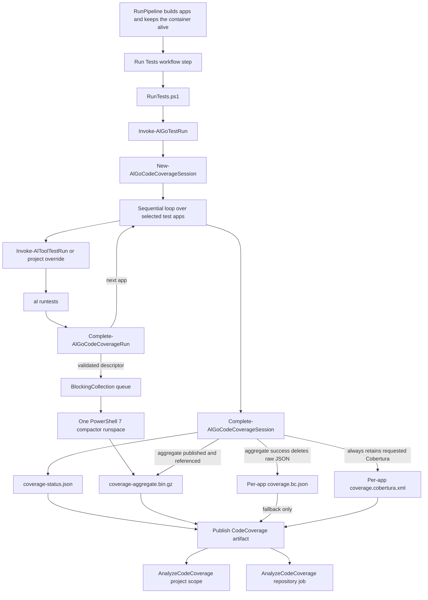
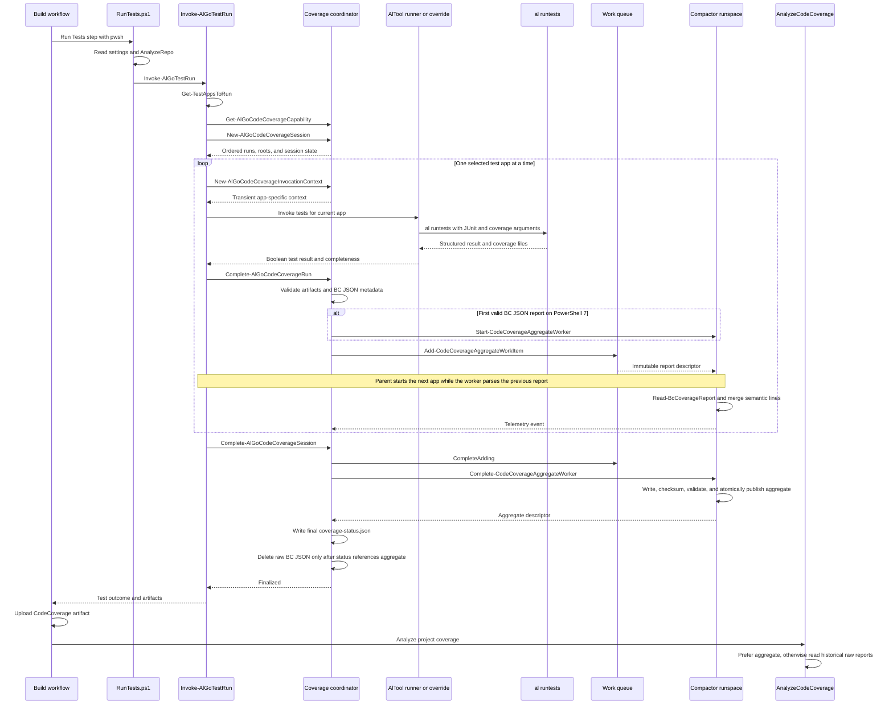

# RunTests code coverage architecture

This document describes the developer-facing control flow, concurrency model, file contracts, and failure behavior for code coverage in the separate RunTests action.

The implementation deliberately separates four responsibilities:

1. RunTests selects test apps and invokes each app's tests.
1. AlTool runs tests and produces JUnit and coverage output.
1. The coverage coordinator validates each app's output and manages the coverage session.
1. A single background compactor streams valid BC JSON reports into one AL-Go aggregate for later analysis.

AnalyzeCodeCoverage runs after RunTests and artifact upload. It reads the final status and either consumes the aggregate or uses historical raw BC JSON reports.

## End-to-end workflow



The workflow uploads the CodeCoverage artifact before running the project summary. Repository summaries run in a separate job after the build jobs and download every matching CodeCoverage artifact.

## Detailed call sequence



## Concurrency model

### Inside one RunTests action

- Test apps are producers and run sequentially in `Invoke-AlGoTestRun`. There is no parallel AlTool test execution within one project job.
- Compaction has exactly one consumer. `Start-CodeCoverageAggregateWorker` creates a separate PowerShell runspace with `PowerShell.BeginInvoke()`.
- The producer and consumer communicate through `BlockingCollection[object]`.
- The worker is started lazily after the first report passes artifact and metadata validation.
- Each subsequent valid report is enqueued as an immutable descriptor. The parent immediately proceeds to the next app.
- The worker parses one report at a time. There is no parser pool and no concurrent mutation of the semantic line union.
- `Complete-AlGoCodeCoverageSession` closes the queue and waits for the worker. This final drain is the only point where RunTests must wait for outstanding compaction.
- The parent is the only writer of `coverage-status.json`. The worker never writes status.

This design overlaps CPU and I/O-heavy report parsing with the next AlTool test run while avoiding locks around the aggregate model.

### Across workflow jobs

Build matrix jobs can run in parallel. Each project and build-mode job owns its own coverage directory, session, queue, and worker. No compactor is shared across jobs.

The repository AnalyzeCodeCoverage job starts after the build jobs. It downloads their artifacts and merges project models logically for the repository summary. It does not modify the uploaded artifacts.

## Function call map

| Function or step | Called by | When it runs | Responsibility |
| :-- | :-- | :-- | :-- |
| `RunTests.ps1` | RunTests composite action | Once per project build job | Reads settings, reconnects to the kept container, loads overrides, and calls the module orchestrator. |
| `Invoke-AlGoTestRun` | `RunTests.ps1` | Once per project build job | Selects apps, creates the coverage session, runs every app sequentially, finalizes coverage, preserves JUnit, and reports the test outcome. |
| `Get-TestAppsToRun` | `Invoke-AlGoTestRun` | Before session creation | Selects compiled test apps and optionally installed test apps. |
| `Get-AlGoCodeCoverageCapability` | `Invoke-AlGoTestRun` | Once when coverage is requested | Accepts coverage only for container platform 30.0.56026.0 or later. |
| `New-AlGoCodeCoverageSession` | `Invoke-AlGoTestRun` | Once before the app loop | Resolves ordered source roots and creates minimal ordered per-app run records. |
| `New-AlGoCodeCoverageInvocationContext` | App loop | Immediately before invoking one app | Projects shared session values and the derived app output path into a transient version 2 override context. |
| `Resolve-CodeCoverageSourceRootData` | Session creation | Once for a supported session | Collects existing app and test roots from the project and direct `projectsToTest`, rejects unsafe paths, deduplicates, and sorts roots. |
| `Invoke-AlToolTestRun` | App loop or opted-in override | Once per selected test app | Enumerates tests, invokes AlTool, appends JUnit, surfaces diagnostics, and returns test success plus coverage completeness. |
| `Invoke-AlRunTestsBatch` | `Invoke-AlToolTestRun` | Once per app with test codeunits | Builds the `al runtests` arguments, invokes the native process, and parses its structured output. |
| `Complete-AlGoCodeCoverageRun` | App loop | Immediately after one supported invocation | Validates fixed artifacts and metadata, assigns the final run state, starts the worker if needed, and enqueues the report. |
| `Test-CodeCoverageArtifacts` | Per-run completion | Before enqueue | Checks requested files, schema version, mode, and agreement between structured completeness and BC JSON. |
| `Start-CodeCoverageAggregateWorker` | Per-run completion | Lazily for the first valid BC JSON report | Creates the queue, event queue, and single background PowerShell runspace. |
| `Add-CodeCoverageAggregateWorkItem` | Per-run completion | Once per valid complete or incomplete report | Adds sequence, app identity, state, completeness, and raw report path to the queue. |
| `Invoke-CodeCoverageAggregateWorker` | Background runspace | Until the queue is closed | Streams reports, evaluates diagnostics, and maintains the canonical OR-covered semantic line union. |
| `Complete-AlGoCodeCoverageSession` | `Invoke-AlGoTestRun` | Once after the app loop, including error paths | Resolves unfinished states, drains compaction, writes final status, performs safe cleanup, and enforces coverage failures. |
| `Complete-CodeCoverageAggregateWorker` | Session completion | During final drain | Closes the queue, waits for the runspace, returns the validated aggregate descriptor, and disposes worker resources. |
| `Write-CodeCoverageStatusInternal` | Session completion | Once, with one fallback rewrite only if aggregate referencing fails | Atomically publishes the final status. There are no intermediate status writes. |
| `AnalyzeCodeCoverage.ps1` | Project step or repository job | After coverage artifact publication | Loads settings, builds the requested model, logs details, and appends Markdown to the job summary. |
| `Get-ProjectCoverageModelFromStatus` | Analyzer | Once per status file | Validates status and aggregate contracts, or reads raw reports when no aggregate descriptor exists. |
| `Get-RepositoryCoverageModel` | Repository analyzer | Once after artifact download | Checks expected build dimensions and combines project application models without double-counting semantic lines. |

## Per-app runner paths

### Built-in runner

`Invoke-AlToolTestRun` performs these steps:

1. Set the container username and password only in process environment variables.
1. Enumerate enabled test codeunits through BcContainerHelper and apply `testType` and disabled-test filtering.
1. Create empty valid JUnit and coverage artifacts when the app has zero test codeunits.
1. Resolve the container connection and company.
1. Call `Invoke-AlRunTestsBatch`.
1. Append test results to the shared project `TestResults.xml`.
1. Return a Boolean test result.
1. Remove credential environment variables in `finally`.

When coverage is supported, `Invoke-AlRunTestsBatch` adds:

```text
--coverage line
--coverage-output <per-app-directory>
--coverage-format <format>
--coverage-source-root <ordered-root>
```

The format and source-root flags are repeated for every configured value.

An AlTool exit code of 1 can represent failed tests. Valid coverage and JUnit data are still processed. Unexpected native failures, invalid structured output, or missing requested coverage output throw.

### Project override

A coverage-aware `.AL-Go/RunTestsInBcContainer.ps1` receives:

- Historical test parameters in `$parameters`.
- Coverage-only contract version 2 data in `$codeCoverageContext`.

The override runs once per app and must return a Boolean test result. For supported coverage it must write coverage into `coverageOutputPath` and set `coverageIsComplete`. AL-Go retains ownership of artifact validation, run state, compaction, and status publication.

For unsupported coverage, `supported` is false and the override must run tests normally without requesting coverage.

## Coverage session lifecycle

### 1. Capability

Coverage is requested only when `useSeparateTestAction.codeCoverageEnabled` is true. The container platform handoff must parse as version 30.0.56026.0 or later.

If the platform is missing, malformed, or older:

- A warning explains the requirement.
- Tests continue without coverage arguments.
- The final status records each selected app as `unsupported`.

### 2. Session construction

The session contains:

- Project identity and build mode.
- Requested formats. Executable-line mode is a module constant.
- Ordered repository-relative source roots and source-root details.
- One minimal ordered run record per app.
- The canonical coverage root from which per-app, status, and aggregate paths are derived.
- The repository root needed by the streaming reader.
- Optional live PowerShell 7 worker state.

Source-root order is deterministic. It is part of the report mapping contract and the aggregate fingerprint.

The public override context is not retained in the run record. RunTests creates a fresh context immediately before each invocation, reads `coverageIsComplete` afterward, and passes that value explicitly to run completion. Session-wide AlTool paths, formats, mode, and source roots are therefore not duplicated for every app.

### 3. Per-app completion

After each runner invocation, the coordinator validates:

- The runner supplied a Boolean completeness value.
- Every requested fixed artifact exists.
- BC JSON is a valid complete document.
- `schemaVersion` is `1.0`.
- Report mode is the requested session mode.
- Structured and file completeness agree.

The run becomes `complete`, `incomplete`, or `failed`. Test pass or failure is independent from coverage completeness, so a failed test app can still contribute valid coverage.

### 4. Background compaction

For every queued report, the worker:

1. Streams the report with `Read-BcCoverageReport`.
1. Validates the full JSON document and required schema.
1. Discards unused test, method, procedure-edge, and source payload after validation.
1. Resolves executable lines to the ordered source roots.
1. Evaluates diagnostic effects for included and excluded sources.
1. Merges lines by canonical semantic identity.

Duplicate line facts use OR semantics: a semantic line is covered when any duplicate has a positive hit count.

The worker retains only:

- Global aggregate metadata.
- Per-run diagnostic assessments.
- The semantic executable-line union.
- Ordering and telemetry needed for deterministic output.

### 5. Final publication

The worker writes the aggregate to a unique temporary path, calculates its SHA-256, validates the temporary file and source-root fingerprint, and atomically moves it to `coverage-aggregate.bin.gz`.

The parent then:

1. Verifies that the aggregate contains every valid run.
1. Writes one final `coverage-status.json` through a temporary file and atomic move.
1. Deletes per-app `coverage.bc.json` only after status durably references the aggregate.
1. Retains per-app Cobertura output.
1. Reports session and overlap telemetry.

## On-disk contracts

Successful PowerShell 7 compaction normally leaves:

```text
.buildartifacts/CodeCoverage/
|-- coverage-status.json
|-- coverage-aggregate.bin.gz
|-- <test-app-guid>/
|   `-- coverage.cobertura.xml
`-- <another-test-app-guid>/
    `-- coverage.cobertura.xml
```

Fallback or Windows PowerShell 5.1 execution leaves raw reports:

```text
.buildartifacts/CodeCoverage/
|-- coverage-status.json
|-- <test-app-guid>/
|   |-- coverage.bc.json
|   `-- coverage.cobertura.xml
`-- <another-test-app-guid>/
    |-- coverage.bc.json
    `-- coverage.cobertura.xml
```

`coverage-status.json` contains project metadata, ordered source roots, final run states, and an optional aggregate descriptor. The descriptor includes the format, contract version, relative path, checksum, source-root fingerprint, run count, line count, and size.

The aggregate is an AL-Go contract, not an AlTool schema 1.0 document. It contains the data required to reproduce existing project and repository line summaries without reparsing raw reports.

## Analyzer selection and validation

`Get-ProjectCoverageModelFromStatus` treats the status as authoritative:

- If status has no aggregate descriptor, it reads per-run `coverage.bc.json`. This preserves historical artifacts and the compaction fallback.
- If status has an aggregate descriptor, it validates the descriptor, path containment, checksum, source-root fingerprint, header metadata, run identities, counts, and size.
- A declared but missing, corrupt, or mismatched aggregate fails closed. The analyzer does not silently fall back to raw reports after an aggregate was published.

Only regular application roots contribute to rates and uncovered-object tables. The aggregate preserves the diagnostic assessment and excluded-fact accounting for test roots and external objects, but those facts do not affect application percentages.

Repository analysis verifies the expected project and build-mode dimensions from `buildOrderJson`, then unions canonical lines across valid project models.

## Failure and cleanup rules

| Condition | Test execution | Coverage result | Raw BC JSON |
| :-- | :-- | :-- | :-- |
| Coverage disabled | Unchanged | No session or status | Not created |
| Unsupported platform | Runs normally | Final `unsupported` states and warning | Not created |
| Test assertions fail but coverage is valid | Test result remains failed or warning per settings | Valid report is compacted and analyzed | Deleted after aggregate publication |
| Supported coverage output is missing or invalid | Fails closed | Run becomes `failed` and its output is not authoritative | Retained when the session uses raw fallback; otherwise subject to normal post-publication cleanup |
| Worker enqueue or parse fails | Continues to finalization | Warning and historical raw-report fallback | Retained |
| Aggregate validation or publication fails | Continues with raw fallback unless another coverage failure exists | Status has no aggregate descriptor | Retained |
| Status cannot reference a valid aggregate | Aggregate publication is removed and status is rewritten for raw fallback | Raw path remains authoritative | Retained |
| Aggregate succeeds but raw deletion fails | Warning | Aggregate remains authoritative | Undeleted files may also be uploaded |
| Earlier runner exception exists | Original exception wins | Best available final status is written with suppressed secondary failure | Retained as needed |

## Telemetry

Per-report compactor logs include:

- App ID and report bytes.
- Queue wait and queue depth.
- Parse duration.
- Extracted, accepted, new, and aggregate line counts.
- Process private memory before and after parsing.

Session completion logs include:

- Run and line counts.
- Total active parse time.
- Final drain time.
- Aggregate size.
- Removed raw bytes.
- Number of reports whose parsing overlapped another app's test execution.

No report content or credentials are logged.

## Change checklist

When changing this flow:

1. Keep test app execution and test-result semantics independent from coverage completeness.
1. Keep the parent as the only status writer.
1. Do not delete raw reports before aggregate publication, validation, and durable status reference.
1. Preserve deterministic source-root, run, and semantic-line ordering.
1. Keep aggregate and historical raw analyzer paths equivalent.
1. Test complete, incomplete, failed-test-valid-coverage, zero-codeunit, duplicate-line, diagnostics, multi-run, and repository cases.
1. Test worker startup, queue drain, worker failure, corruption, fingerprint mismatch, atomic publication, cleanup, and fallback.
1. Run RunTests and analyzer suites in PowerShell 7 and supported consumer tests in Windows PowerShell 5.1.

The primary implementation and tests are:

- `Actions/RunTests/RunTests.psm1`
- `Actions/RunTests/CodeCoverageCoordinator.psm1`
- `Actions/RunTests/AlToolTestRunner.psm1`
- `Actions/.Modules/CodeCoverageAggregate.psm1`
- `Actions/.Modules/CodeCoverageAggregateFormat.psm1`
- `Actions/.Modules/CodeCoverageReportReader.psm1`
- `Actions/AnalyzeCodeCoverage/AnalyzeCodeCoverage.psm1`
- `Tests/RunTests.Test.ps1`
- `Tests/CodeCoverageCoordinator.Test.ps1`
- `Tests/CodeCoverageAggregate.Test.ps1`
- `Tests/AnalyzeCodeCoverage.Test.ps1`
